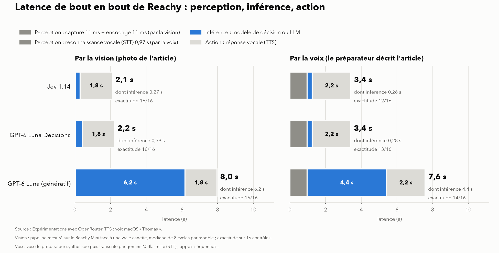

# reachy-jev : Reachy contrôle les commandes

Les **modèles de décision** sont une nouvelle famille d'IA : ils ne génèrent pas de texte, ils répondent à des questions fermées avec une probabilité. Leur promesse : décider beaucoup plus vite et beaucoup moins cher qu'un LLM. Ce dépôt la teste sur un robot Reachy Mini, avec trois IA qui prennent la même décision :

- **Jev 1.14** (TypeSafe), modèle de décision ;
- **GPT-6 Luna Decisions** (OpenAI), modèle de décision ;
- **GPT-6 Luna** (OpenAI), le LLM génératif dont il dérive.

## Le cas d'usage

On donne à Reachy une ligne de commande, par exemple « 1 canette de San Pellegrino », et on lui présente l'article : **devant sa caméra**, ou **décrit à voix haute** par le préparateur (une reconnaissance vocale transcrit sa phrase). L'IA répond à deux questions, *est-ce le bon produit ?* et *est-il abîmé ?*, puis Reachy réagit à voix haute et d'un geste : il hoche la tête pour valider, la secoue si ce n'est pas le bon produit, fait la moue si l'article est abîmé, la penche s'il doute.

## Résultats



| Modèle | Inférence (vision) | De bout en bout, vision | De bout en bout, voix | Exactitude, vision · voix | Coût par million, vision · voix |
|---|---|---|---|---|---|
| Jev 1.14 | **0,27 s** | **2,1 s** | 3,4 s | 16/16 · 12/16 | 83 $ · 17 $ |
| GPT-6 Luna Decisions | **0,39 s** | **2,2 s** | 3,4 s | 16/16 · 13/16 | 90 $ · 33 $ |
| GPT-6 Luna (génératif) | 6,2 s | 8,0 s | 7,6 s | 16/16 · 14/16 | 116 $ · 70 $ |

Latences médianes ; par la vision, mesurées sur le Reachy Mini face à une vraie canette. Exactitude sur 16 contrôles étiquetés par mode. Tous les chiffres sont produits par le code, dans [`resultats/`](resultats/).

**Ce qu'il faut retenir**

- **La latence.** Un modèle de décision tranche en 0,3 s, le génératif en 6 s, et ce dernier varie fortement d'un jour à l'autre (2,6 s deux jours plus tôt).
- **De bout en bout, l'écart se réduit à 2 à 4 fois.** Une fois la décision rapide, c'est la phrase du robot qui prend le plus de temps.
- **La justesse.** Aucune erreur avec la caméra. À la voix, toutes les erreurs viennent de la transcription, qui comprend mal une phrase sur deux (« toute froissée » devient « toute propre »).
- **Le coût.** Jev est 1,4 fois moins cher que le génératif sur une image, 3 à 4 fois sur une phrase : loin des « 40 à 400 fois » annoncés.
- **Jev contre OpenAI.** Jeu égal sur ce cas. Jev compte l'image plus cher en tokens, mais chaque question supplémentaire ne lui coûte presque rien.

Méthode, détail de chaque passage, tokens, prix de l'API, limites et piste de suite : [docs/ANALYSE.md](docs/ANALYSE.md).

## Lancer le projet

Il faut [uv](https://docs.astral.sh/uv/), une [clé OpenRouter](https://openrouter.ai/settings/keys) (5 $ de crédit suffisent largement) et, pour les mesures sur le robot, un Reachy Mini sur le même Wi-Fi.

```bash
cp .env.example .env                    # puis colle ta clé OpenRouter dans .env
uv sync
uv run reachy-jev stt                   # transcrit les phrases du préparateur, à lancer avant le mode voix
uv run reachy-jev banc                  # refait l'expérimentation, vision puis voix (~4 min, < 1 centime)
uv run reachy-jev banc --redessiner     # refait tableaux et graphiques sans nouvel appel
uv run reachy-jev bout-en-bout --commande "1 canette de San Pellegrino"   # pipeline complet sur le robot
uv run reachy-jev demo                  # contrôle en direct : caméra, voix et gestes de Reachy
uv run pytest                           # 23 tests, sans réseau ni robot
```

Si le robot n'est pas trouvé sous `reachy-mini.local`, mets son adresse IP dans `REACHY_HOTE` (fichier `.env`).

## Structure

```
src/reachy_jev/
  controle.py    le cas d'usage : les deux questions, puis le verdict tranché par le code
  openrouter.py  appels à l'API avec latence et coût mesurés
  robot.py       le Reachy Mini par le réseau : caméra, gestes, parole
  camera.py      les mesures sur le robot (aucune image enregistrée)
  stt.py         la reconnaissance vocale de la phrase du préparateur
  voix.py        les phrases du robot, synthétisées une fois puis en cache
  banc.py        l'expérimentation, les tableaux et les graphiques
  cli.py         les commandes
  reglages.py    les trois IA, les seuils, la clé
data/                les 16 contrôles et les 8 photos (crédits dans data/photos/CREDITS.md)
resultats/           toutes les mesures et les graphiques
docs/                l'analyse détaillée et les notes sur Jev
```
